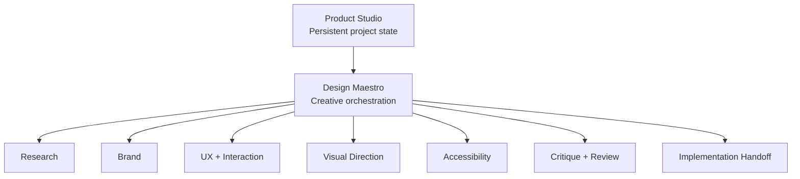
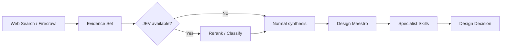

# Design Maestro

**Design Maestro is a design-orchestration skill for AI agents.** It behaves like a product/design director: it frames the problem, chooses the right specialists, sequences the work, resolves conflicts, and turns the result into a coherent handoff.

It is deliberately **not** a coding-first skill and deliberately **not** a single visual style.

Design Maestro can coordinate skills for research, branding, frontend art direction, interaction, accessibility, responsive adaptation, critique, design review, SEO, AI discovery, and implementation. Optional integrations with **JEV / TypeSafe AI** and **Firecrawl** can accelerate routing, research filtering, and readiness gates, but the skill works without them.

## What problem it solves

AI-generated interfaces often fail for predictable reasons:

- they jump to components before understanding the product
- they apply a fashionable style without a product reason
- they invoke too many overlapping design checklists
- implementation libraries become the visual identity
- research becomes a pile of links instead of evidence
- design decisions disappear between sessions
- "review" becomes subjective taste rather than task impact

Design Maestro introduces a simple discipline:

```text
Product -> Evidence -> Direction -> Experience -> System -> Review -> Handoff -> Code
```

Not:

```text
Prompt -> React -> Cards -> Gradient -> Done
```

## Relationship to Product Studio

Design Maestro is the **fast, reusable creative director**.

Product Studio is the **persistent operating system** for longer projects.



Use Design Maestro alone for a focused task. Use Product Studio when decisions must survive multiple sessions, agents, branches, or weeks of work.

## Typical use cases

- Create a new company website from a short brief.
- Redesign an existing landing page without destroying the brand.
- Develop 2-3 genuinely different design territories before implementation.
- Review a dashboard or application branch for hierarchy and UX quality.
- Turn a brand concept into a consistent web direction.
- Coordinate accessibility, responsive adaptation, and motion specialists.
- Prepare an implementation handoff for Codex, Claude, or another engineer/agent.
- Run a public-site SEO/AI-discovery pass after the product story is stable.

## Installation

Package this directory as a compatible agent skill or install the distributed `skill.zip` in the skill system supported by your agent.

The skill assumes specialist skills may or may not be installed. Missing optional specialists do not break the workflow.

## Minimal usage

```text
Use Design Maestro to create a new website for my B2B product.
Do not code yet. Start with product framing and three design territories.
```

```text
Use Design Maestro to review this landing page.
Preserve the brand. Focus on hierarchy, conversion clarity, accessibility, and visual differentiation.
```

```text
Use Design Maestro to redesign this dashboard.
The main goal is faster scanning and clearer action states, not a marketing-style visual refresh.
```

## Recommended workflow for a new website

### 1. Frame the product

Design Maestro first determines:

- Who is this for?
- What should a visitor understand immediately?
- What action matters most?
- What proof reduces hesitation?
- What already exists and should remain?
- What should the experience feel like?
- What should it explicitly avoid?

The output is a compact design brief, not code.

### 2. Research only useful questions

Examples:

- How do direct competitors explain the category?
- What proof signals are common?
- What page structures are overused?
- What language does the audience already understand?
- Where is there room to look and behave differently?

Ordinary web search is the default. Firecrawl is optional for deeper crawling/extraction.

### 3. Explore Design Territories

For high-concept work, Design Maestro can propose up to three distinct territories.

A good territory changes more than color. It should have its own:

- design thesis
- information rhythm
- typography character
- composition
- imagery system
- interaction character
- signature moment
- risk/tradeoff

Example:

```text
Territory A - Precision Infrastructure
Technical, disciplined, dark, diagrammatic, high-trust.

Territory B - Editorial Intelligence
Large typography, calm whitespace, evidence-first storytelling.

Territory C - Autonomous Motion
More kinetic, system-driven, product demonstrations as the visual language.
```

### 4. Build the experience blueprint

Once a direction is selected, define:

- sitemap/screen map
- hierarchy
- navigation
- section order
- primary/secondary actions
- proof and trust moments
- loading/empty/error/success states
- responsive transformations
- interaction states

### 5. Define the visual system

Document conceptual tokens before code:

- type roles
- colors and semantic roles
- spacing rhythm
- grid/container logic
- depth/elevation
- icon and imagery language
- radii/shapes
- motion principles

### 6. Review and hand off

Run one broad review, then targeted specialists where necessary. Turn approved decisions into a concise implementation handoff.

## Specialist orchestration

Design Maestro does not copy every specialist's rules. It routes to the current specialist skill and treats that skill as the source of truth.

Typical routing:

| Need | Specialist example |
| --- | --- |
| Distinctive web direction | `frontend-design` |
| Identity / visual world | `brandkit` |
| Editorial minimalism | `minimalist-ui` |
| Apple-platform guidance | Apple HIG skills |
| Interaction / motion | `interaction-design` |
| High-craft polish | `emil-design-eng` |
| Responsive transformation | `adapt` |
| Accessibility | `accessibility` |
| Concept critique | `critique` |
| Pre-ship review | `design-review` |
| Broad interface review | `better-interface` |
| Current web guidelines | `web-design-guidelines` |
| On-page SEO | `seo-audit` |
| AI discovery | `ai-seo` |
| Implementation with shadcn | `shadcn` |
| Claude transfer | `claude-handoff` |

The exact installed catalog may differ. The router should verify live specialist metadata before relying on it.

## Optional JEV / TypeSafe AI integration

JEV is useful when the design workflow contains many small structured decisions.

Recommended uses:

### Intent routing

```text
Request -> [create | redesign | review | brand | discover | grow | handoff]
```

### Skill routing

Given the request plus current skill catalog, select the smallest relevant specialist set.

### Research reranking

```text
web/firecrawl results -> JEV relevance classification -> smaller evidence set -> creative synthesis
```

### Readiness gates

Examples:

- audience defined?
- primary action clear?
- responsive rules documented?
- interaction states covered?
- accessibility requirements included?

JEV should not create the visual direction or select an unquestioned "winning" design. It accelerates atomic decisions; Design Maestro and the human retain creative judgment.

TypeSafe AI currently expects authenticated API access for its quick-start flow, commonly via `TYPESAFE_API_KEY`. If JEV is unavailable, Design Maestro uses ordinary reasoning.

## Optional Firecrawl integration

Firecrawl is most useful for:

- crawling competitor sites
- extracting several pages into clean Markdown
- discovering a site's URL structure
- building structured research sets
- working with dynamic sites when plain retrieval is weak

As of the documentation snapshot referenced by this skill, basic initial `search`/`scrape` requests can be tried without an API key; authenticated access with `FIRECRAWL_API_KEY` is useful for higher limits and production use.

Design Maestro must always have a fallback to ordinary browsing/search.

## Research + JEV + Maestro pattern



## Review philosophy

Different reviews answer different questions:

- **Critique**: Is the idea strong, clear, coherent, and differentiated?
- **Design review**: Is the artifact crafted well enough to ship?
- **Accessibility review**: Can people operate and understand it across relevant needs?
- **Web guideline review**: Does the implementation follow current interface standards?

Do not run every review by default. Use the smallest set that covers the actual risk.

## Source-of-truth rule

Meta-skills get stale if they describe other skills as though their behavior never changes.

Therefore:

1. The Design Maestro registry is only a routing hint.
2. When a specialist becomes important, load the current specialist instructions.
3. Follow the specialist's current rules.
4. Return to Design Maestro to reconcile the result with the approved product direction.

## Design Maestro vs Product Studio

Choose Design Maestro when:

- the task is focused
- the project state already exists elsewhere
- the work can be resolved in one or a few sessions
- you need orchestration, critique, or a handoff

Choose Product Studio when:

- the project will span multiple sessions
- multiple agents will contribute
- design decisions need a durable source of truth
- research, brand, UX, and QA must evolve together
- you want `.design/` documentation that survives implementation cycles

## Example: new AI company website

```text
Use Design Maestro.

Goal: create the website direction for an AI infrastructure company.
Audience: engineering leaders and technical founders.
Do not code yet.
Research the category only where it changes a design decision.
Propose three genuinely different design territories.
For each, explain the thesis, structure, visual language, signature moment, and risk.
After we choose one, create the experience blueprint and implementation handoff.
```

Likely orchestration:

```text
Frame
 -> research
 -> optional Firecrawl
 -> optional JEV rerank
 -> frontend-design
 -> maybe brandkit
 -> selected territory
 -> interaction-design
 -> accessibility
 -> critique/design-review
 -> SEO/AI SEO if public
 -> handoff
```

## Example: review an existing product branch

```text
Use Design Maestro to review this branch.
Do not redesign the product just to make it prettier.
Preserve successful interaction patterns.
Prioritize blocked tasks, hierarchy, states, responsiveness, and accessibility.
End with a prioritized implementation handoff.
```

## What Design Maestro intentionally does not do

- It does not make every product look minimal.
- It does not make every product look Apple-like.
- It does not force a specific UI library.
- It does not replace user research.
- It does not use JEV as a creative oracle.
- It does not require Firecrawl.
- It does not dump every specialist into every project.
- It does not start with code unless implementation is already the task.

## Repository structure

```text
design-maestro/
├── SKILL.md
├── README.md
├── agents/
│   └── openai.yaml
├── assets/
│   └── design-maestro-architecture.png
└── references/
    ├── decision-layer.md
    ├── deliverables.md
    ├── examples.md
    ├── quality-bar.md
    ├── routing.md
    ├── skill-registry.md
    └── workflows.md
```

## Security and secrets

Never write API keys into design artifacts, Markdown state, git history, screenshots, or handoffs.

Use environment variables or the secret mechanism supported by the runtime:

```text
TYPESAFE_API_KEY=...
FIRECRAWL_API_KEY=...
```

Only request/configure them when the optional integration is actually being used.

## External references

- Firecrawl docs: https://docs.firecrawl.dev/introduction
- TypeSafe AI / JEV docs: https://docs.typesafe.ai/introduction
- JEV quick start: https://docs.typesafe.ai/introduction/quickstart
- JEV skill suggestion cookbook: https://docs.typesafe.ai/cookbooks/skill_suggestion
- JEV patterns: https://docs.typesafe.ai/patterns

## License / provenance

Design Maestro is an orchestration skill. Specialist names are references to independent skills/projects and do not imply ownership, endorsement, or bundled redistribution of those skills.
