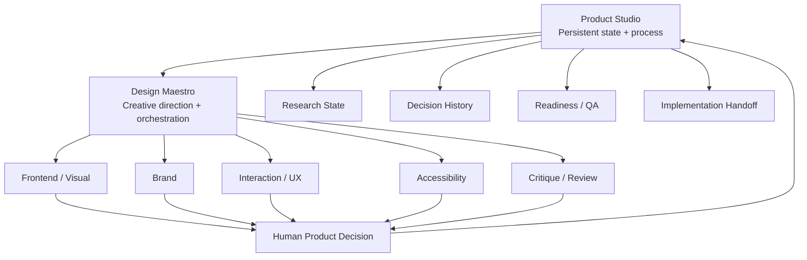
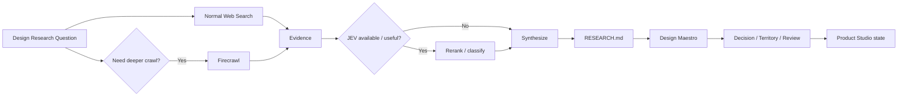

# Product Studio

**Product Studio is a persistent Product + Design Operating System for AI-assisted projects.**

It keeps the important parts of product and design work alive across sessions: what the product is, who it is for, what was researched, which design direction was approved, why a decision was made, how the experience behaves, what is ready to build, and what implementation must preserve.

It is designed to work together with **Design Maestro**:

- **Design Maestro** = creative director / orchestrator.
- **Product Studio** = persistent studio / project memory / operating model.

You can use Design Maestro alone for a focused task. Use Product Studio when the project needs continuity.

---

## Why this exists

Long-running AI design work often loses quality because every new session partially restarts the reasoning.

A new agent sees the code, but not necessarily:

- why the navigation is structured that way
- why a rejected visual direction was rejected
- which competitor pattern was intentionally avoided
- which user job is more important than another
- what "premium" actually means for this product
- which accessibility requirement is non-negotiable
- which part of the design is an experiment vs an approved decision

Product Studio turns that invisible reasoning into a compact, project-local source of truth.

```text
Conversation memory is helpful.
Project state is durable.
```

---

# The two-layer system



Product Studio does not replace creative skills. It coordinates the lifecycle around them.

---

# When to use Product Studio

Use it when one or more of these are true:

- the project spans multiple sessions
- several agents or humans will contribute
- you are building a substantial website, product, dashboard, or brand system
- research should remain available later
- design direction must survive implementation
- you want explicit readiness gates before code or release
- you expect redesign cycles
- you need a clear handoff from product/design to engineering

For a single critique or a one-off landing page concept, Design Maestro alone may be enough.

---

# What it creates

In a writable project, Product Studio creates a `.design/` workspace:

```text
.design/
├── BRIEF.md
├── PRODUCT.md
├── RESEARCH.md
├── BRAND.md
├── DESIGN.md
├── EXPERIENCE.md
├── CONTENT.md
├── DECISIONS.md
├── QA.md
├── HANDOFF.md
├── territories/
├── references/
└── reviews/
```

This directory is intentionally framework-agnostic. It can live next to React, Vue, Swift, Rails, a static site, a design prototype, or even a non-code project.

---

# File-by-file mental model

| File | Owns |
| --- | --- |
| `BRIEF.md` | Project frame, scope, constraints, phase |
| `PRODUCT.md` | Audience, jobs, promise, value, success |
| `RESEARCH.md` | Evidence, sources, implications |
| `BRAND.md` | Brand personality and identity direction |
| `DESIGN.md` | Approved visual/interface system |
| `EXPERIENCE.md` | IA, flows, states, responsive behavior, accessibility |
| `CONTENT.md` | Message hierarchy, claims, proof, CTAs, terminology |
| `DECISIONS.md` | Durable major decision history |
| `QA.md` | Current readiness and review status |
| `HANDOFF.md` | Current contract for implementation |

Explorations go into `territories/`.
Reviews go into `reviews/`.
Project-specific source material can go into `references/`.

---

# The most important rule: ownership

Do not repeat the same rule in five documents.

If typography changes, update the owning design/brand document and record a major decision if necessary.

If the audience changes, update `PRODUCT.md`, not `DESIGN.md`.

If a review finds a problem, the review is evidence. Once the change is approved, update the authoritative document that owns the behavior.

This keeps `.design/` usable instead of turning it into a pile of stale notes.

---

# Quick start

## 1. Install the skill

Install the packaged Product Studio skill in the skill system supported by your agent.

For the best experience, also install **Design Maestro** and the specialist design skills relevant to your work.

## 2. Start in a project directory

Prompt:

```text
Use Product Studio for this project.
Initialize the design workspace and capture everything we already know.
Do not code yet.
```

The skill should create missing `.design/` files without overwriting existing state.

## 3. Ask for a product/design workflow

Example:

```text
Use Product Studio + Design Maestro to redesign our website.
Start from the existing project state.
Research competitors only where it can change a decision.
Create three distinct design territories before implementation.
```

## 4. Choose and record a direction

When you choose a territory, Product Studio records the decision and updates the appropriate source-of-truth documents.

## 5. Move to implementation only after build readiness

Example:

```text
Check build readiness.
List only blocking gaps and the evidence for them.
If ready, update HANDOFF.md for the implementation agent.
```

---

# Example full website workflow

Suppose you are creating a new website for an AI company.

## Phase A - Orient

Product Studio reads/creates:

- `BRIEF.md`
- `PRODUCT.md`
- `DECISIONS.md`

It determines what is already known and what would actually block design work.

## Phase B - Research

Questions might include:

- What language is already established in the category?
- What proof patterns do credible competitors use?
- Which AI-site visual tropes are overused?
- Which product concepts need explanation before a buyer trusts them?

The synthesis goes into `RESEARCH.md`.

## Phase C - Product story

`PRODUCT.md` and `CONTENT.md` establish:

- product promise
- visitor priority
- proof model
- message hierarchy
- CTA structure

## Phase D - Design territories

Design Maestro explores directions such as:

```text
01 - Precision Infrastructure
02 - Editorial Intelligence
03 - Autonomous Motion
```

Each becomes a territory file with thesis, structure, visual language, interaction character, signature moment, and tradeoffs.

## Phase E - Human choice

The user/product owner chooses a direction.

That choice is written to `DECISIONS.md`.

## Phase F - System

Product Studio updates:

- `BRAND.md`
- `DESIGN.md`
- `EXPERIENCE.md`

## Phase G - Build-ready

`QA.md` checks whether implementation has enough information about:

- hierarchy
- content
- system
- states
- responsiveness
- accessibility
- implementation constraints

## Phase H - Handoff

`HANDOFF.md` becomes the implementation contract.

---

# JEV / TypeSafe AI: optional System-One layer

Product Studio supports JEV as an **optional decision accelerator**.

JEV should not design the product. It helps with many small structured decisions that otherwise waste expensive reasoning.

Recommended uses:

## Intent classification

```text
request -> create | redesign | review | brand | research | handoff
```

## Specialist selection

Given the current task and live specialist-skill catalog:

```text
Which 1-3 specialists are relevant?
```

## Research reranking

```text
Web / Firecrawl
      -> 200 fragments
      -> JEV relevance classification
      -> 30 high-value fragments
      -> Product Studio synthesis
```

## Readiness gates

Examples:

```text
Is the primary audience explicit?
Is the primary CTA explicit?
Are responsive transformations documented?
Are critical error/loading states defined?
Are accessibility constraints included in the handoff?
```

These should be atomic and evidence-backed.

Do **not** ask JEV:

```text
Which design is best?
Create the homepage layout.
Write the brand.
Make this premium.
```

Those remain creative/product problems.

## Authentication

The current TypeSafe AI quick-start flow uses an API key, commonly via:

```bash
export TYPESAFE_API_KEY="..."
```

Do not store the key in `.design/` or commit it.

If JEV is unavailable, Product Studio simply falls back to normal model reasoning.

---

# Firecrawl: optional research depth

Product Studio does **not** require Firecrawl.

Use normal web search when it is sufficient.

Use Firecrawl when you need:

- multi-page crawling
- competitor-site extraction
- URL/site-map discovery
- structured site comparison
- dynamic-page scraping
- larger evidence sets for research

The current Firecrawl docs allow initial `search`/`scrape` use without an API key and recommend authenticated access for higher limits.

When authenticated, a common environment variable is:

```bash
export FIRECRAWL_API_KEY="..."
```

Again: never write secrets to `.design/`.

---

# Combined research architecture



---

# Design Territories

A territory is not a palette option.

A strong territory changes the product expression across several dimensions:

- narrative structure
- content rhythm
- typography
- composition
- density
- imagery
- interaction
- motion
- emotional character
- signature moment

Example territory document:

```markdown
# Editorial Intelligence

Status: Candidate

## Thesis
Treat the company like a research-driven intelligence platform rather than a generic AI SaaS.

## Structure
Evidence-first storytelling, fewer but deeper sections, large editorial transitions.

## Typography
Large editorial display type + precise utilitarian UI text.

## Image direction
Diagrams, annotated artifacts, selective product captures.

## Motion
Calm explanatory transitions; no ambient AI glow.

## Signature moment
A live-looking system diagram that turns the product architecture into the hero proof.

## Risk
Can feel too institutional if product interaction is not shown early enough.
```

---

# Decisions are first-class project state

`DECISIONS.md` prevents the classic AI-project problem where an old option quietly comes back later.

Record meaningful decisions such as:

- target audience changed
- selected design territory
- brand direction approved
- navigation model changed
- hero claim changed
- a specific pattern was rejected
- implementation must preserve a particular behavior

Do not record every spacing tweak as an architecture decision.

---

# Readiness gates

Product Studio uses four useful gates.

## Discovery ready

Enough product/context exists to start exploration.

## Direction ready

Enough product/evidence exists to choose a meaningful direction.

## Build ready

Implementation has sufficient product/design specification.

## Ship ready

The implemented experience has passed the relevant design, responsive, content, accessibility, and discovery checks.

JEV can accelerate atomic checks, but the evidence and product judgment remain visible.

---

# Working with multiple agents

Product Studio is especially useful when Codex, Claude, Grok, OpenCode, or human designers/engineers share a project.

Instead of sending the full history, send the smallest authoritative subset.

Example implementation task:

```text
Implement the responsive navigation.

Authoritative project state:
- .design/DESIGN.md
- .design/EXPERIENCE.md
- .design/DECISIONS.md
- .design/HANDOFF.md

Do not change the approved brand direction.
If implementation constraints require a design deviation, report it separately before modifying the source-of-truth design state.
```

This sharply reduces accidental redesign by implementation agents.

---

# Recommended specialist stack

Product Studio itself does not need every specialist installed.

Potential specialists include:

- Design Maestro
- frontend-design
- brandkit
- minimalist-ui
- Apple HIG skills
- interaction-design
- emil-design-eng
- adapt
- accessibility
- critique
- design-review
- better-interface
- web-design-guidelines
- seo-audit
- ai-seo
- shadcn
- claude-handoff

Use only specialists relevant to the current phase.

---

# Product Studio vs a giant single skill

Why not put everything inside one enormous skill?

Because progressive loading is better.

Product Studio should know:

- project state
- workflow
- ownership
- readiness
- orchestration boundaries

Design Maestro should know:

- how to direct design work
- which specialist to ask
- how to synthesize the result

Specialists should know:

- their own domain

This keeps each context smaller and makes individual skills independently upgradable.

---

# Persistence rules

## Persist

- approved decisions
- durable constraints
- research implications
- current product/brand/design direction
- open blockers
- handoff requirements

## Do not persist by default

- raw chat transcript
- every discarded idea
- temporary implementation chatter
- duplicated rules
- secrets

---

# CLI / script helpers

The skill includes two deterministic helpers.

## Initialize workspace

```bash
python scripts/init_design_workspace.py --root . --project-name "My Product"
```

Behavior:

- creates `.design/` if missing
- creates required Markdown files if missing
- creates `territories/`, `references/`, `reviews/`
- does not overwrite existing files unless explicitly forced

## Check workspace

```bash
python scripts/check_design_workspace.py --root .
```

It reports missing and empty required files and provides a simple workspace summary.

---

# Example prompts

## Start a new project

```text
Use Product Studio for this project.
Initialize .design and capture all known context.
Then use Design Maestro to frame the product and propose up to three design territories.
Do not code yet.
```

## Continue an existing project

```text
Use Product Studio and continue from the current .design state.
We are adding pricing and onboarding pages.
Do not reopen already-approved brand decisions unless the new requirements create a real conflict.
```

## Competitor research

```text
Use Product Studio to research direct competitors.
Use normal web search first and Firecrawl only if a deeper crawl adds value.
If JEV is available, use it to rerank/classify evidence, not to write the conclusion.
Update RESEARCH.md with sources, findings, limitations, and design implications.
```

## Design review

```text
Review this branch against the approved Product Studio state.
Use Design Maestro to choose the appropriate review specialists.
Store detailed findings in .design/reviews and keep QA.md limited to current blockers and readiness.
```

## Prepare implementation

```text
Run the build-ready gate.
If blocking gaps exist, list and resolve them first.
Then update HANDOFF.md so an implementation agent can build without reinventing the product or design direction.
```

---

# Security

Never store secrets in Product Studio state.

Do not write any of these into `.design/`:

```text
TYPESAFE_API_KEY
FIRECRAWL_API_KEY
other provider tokens
passwords
private credentials
```

Use environment variables or the runtime's secret manager.

---

# Repository structure

```text
product-studio/
├── SKILL.md
├── README.md
├── agents/
│   └── openai.yaml
├── scripts/
│   ├── init_design_workspace.py
│   └── check_design_workspace.py
└── references/
    ├── operating-model.md
    ├── design-state.md
    ├── workflows.md
    ├── gates.md
    ├── integrations.md
    ├── handoff.md
    └── examples.md
```

---

# External references

- Firecrawl: https://docs.firecrawl.dev/introduction
- TypeSafe AI / JEV: https://docs.typesafe.ai/introduction
- TypeSafe quick start: https://docs.typesafe.ai/introduction/quickstart
- JEV skill suggestion cookbook: https://docs.typesafe.ai/cookbooks/skill_suggestion
- JEV patterns: https://docs.typesafe.ai/patterns

---

# Philosophy

The end goal is not more documentation.

The goal is that weeks later, a new agent can enter the project and understand:

> What are we building?
>
> For whom?
>
> What matters most?
>
> What did we research?
>
> Which direction did we choose?
>
> Why?
>
> What must implementation preserve?
>
> What is still uncertain?

If Product Studio answers those questions without forcing the agent to re-derive the entire project, it is doing its job.
